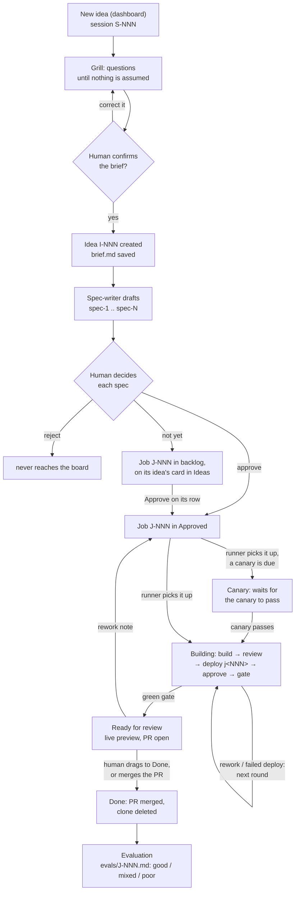
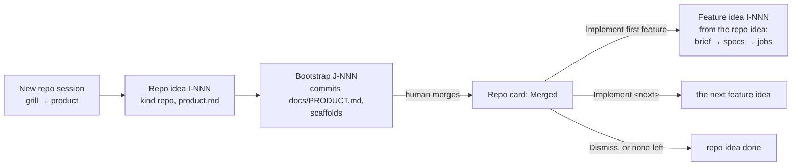

# Factory terminology

What the factory's words mean, and how the ids (`S-`, `I-`, `J-` and the rest) relate.
`FACTORY-CONTRACT.md` is the source of truth; this is a map to it, and where the two differ the
contract wins.

## The chain in one picture

```
S-016  idea session (dashboard)        a conversation: grill -> brief -> specs
  │      or /factory:idea (CLI, no S-)
  ▼
I-015  idea                            created when the human confirms the brief
  ├── brief.md                          the grilled brief, one per idea
  ├── spec-1.md .. spec-N.md            spec-writer drafts (N <= 5), not yet on the board
  │
  ▼  add-spec, one per approved or deferred spec
J-024  job                             one spec, one branch, one PR, one preview
  ├── factory/J-024                     its branch on the target repo
  ├── PR #n                             its pull request (GitHub's number, not the factory's)
  ├── j024                              its Azure preview environment (rg-<project>-j024)
  ├── round-1 .. round-n                build/review/deploy passes
  ├── evals/J-024                       the evaluation once it finishes
  └── lessons/J-024                     what it taught the templates, if it went bad
```

From idea to evaluation, for one job:



One session makes at most one idea. A feature idea makes 1 to 5 jobs; a New repo idea makes one, its
bootstrap. A job belongs to exactly one idea. Everything a job leaves behind is keyed by its `J-` id.

A new app, from the New repo idea to its features (spec 22):



## Terms

**Target.** The GitHub repo (`owner/name`) a job changes, e.g. `kamabery/todoapp-two`. A new
target is a repo that does not exist yet; the factory scaffolds it from `template-projects`.

**Idea session** (`S-NNN`). A dashboard conversation with the Claude API that turns a one-line idea
into a brief and specs (*New idea* panel). It is not on the board, and the model never changes board
state: every board write is a human click. It lives in `.factory-runs/sessions/S-NNN/` and is never
deleted, so `human.jsonl` keeps the human's own words for replaying the idea later. The CLI
fallback, `/factory:idea`, does the same steps without an `S-` id.

**Grill.** The questioning step of a session: the model asks until nothing in the idea is assumed.

**Brief.** The grilled idea written up in the human's words (`factory/templates/brief.md`). The
human confirms it. Confirming it is what creates the idea (`I-NNN`), and the brief is stored as
`ideas/I-NNN/brief.md`. Where the brief and the one-line idea text differ, the brief wins.

**Idea** (`I-NNN`). The board record of what the human wants, on one target. Statuses: `waiting`
(new target, waiting for its bootstrap to merge), `drafting` (open for a session), `done`,
`failed` (every spec rejected), `abandoned`. Shown in the Ideas column until done or abandoned. An
idea is not a job and is never built. A **feature idea** builds on a repo that exists; a **New repo
idea** (`kind: "repo"`) makes the app, and its features are feature ideas started from it (`from`,
`feature`).

**Product** (`docs/PRODUCT.md`). A New repo idea's grilled document in place of a brief
(`factory/templates/product.md`): the app's purpose, its users, its Home decision, and 1 to 10 features in build
order, each a `###` heading. The factory commits it into the bootstrap's branch (`docs: product`) and never edits it
again; it is the app's roadmap, read from the target's `main` whenever the next feature is offered.

**Repo card.** A New repo idea's card in Ideas, marked New repo, with steps Grill → Scaffold → Review → Merged. Once
the scaffold merges it offers **Implement first feature**, then **Implement \<heading\>** for the next feature in
PRODUCT.md with no idea yet, and **Dismiss**. Repos scaffolded before spec 22 have none; they use New idea.

**Implement.** Starts one feature of a repo: a feature session on the repo, seeded with that feature's text, that
grills only what PRODUCT.md and the code leave open. The feature counts as started when its brief is confirmed. The
first feature's specs carry the Home decision. CLI: `factory idea <owner/name> --feature <k>`.

**Spec.** One small, separately buildable piece of an idea (`factory/templates/spec.md`), written
by the spec-writer. A draft is `ideas/I-NNN/spec-<k>.md`, where `k` is its position in the idea
(1..5), not an id. The human approves, defers, revises or rejects each one. Approved and deferred
specs become jobs; a rejected spec never reaches the board. Once it is a job, the spec is
`jobs/J-NNN/spec.md`, and while it waits in `backlog` the human can still edit and approve it on its idea's card in
Ideas (the board has no Backlog column).

**Job** (`J-NNN`). A spec on the board: the unit that is built, reviewed, deployed, gated and
merged. Its card moves Ideas (on its idea's card, until approved) → Approved → Canary (only when a canary is due)
→ Building → Ready for review → Done (or is discarded).
Each job has its own temp clone, branch `factory/J-NNN` and PR. `kind` is `feature` (from a spec)
or `bootstrap`.

**Bootstrap job.** The first job on a new target: it scaffolds the repo from the templates, with a New repo idea's
product committed as `docs/PRODUCT.md`. The idea waits (`waiting`) until the bootstrap merges; then its repo card offers
the features. A bootstrap never deploys, so it never waits for a canary.

**Stacked job / base.** A job built on another job's unmerged branch instead of `main`. The
session's **Base** picks it; the job's `base` field holds that job's `J-` id, and it cannot merge
before its base does.

**Round** (`round-<n>`). One pass of build → review (→ deploy) for a job. A rework or a failed
deploy starts the next round. Rounds are numbered per job, from 1.

**Stage.** Where a job is: `backlog` (on its idea's card in Ideas), `approved`, `canary`, `build`, `review`,
`deploy`, `approve`, `gate`, `blocked`, `ready`, `done`, `discarded`.

**Gate.** The deterministic check (build, tests, UI) `factory` runs on the job's head after the
approver says APPROVE. A green gate moves the job to Ready for review; only a human merges.

**Platform** (`rg-factory-platform`). The previews' shared Container Apps environment, Log Analytics workspace, Key
Vault and Postgres server. **Asleep** means its Postgres server is stopped, the one part with a real idle cost; the
header's platform chip starts it and puts it to sleep, and a canary or a deploy wakes it first (spec 24).

**Preview** (`j<NNN>`). The job's ephemeral Azure environment, named from its job number in lower
case: J-024 deploys to `j024`, resource group `rg-<project>-j024`, HCP workspace
`<repo>-j024`. Previews are never production.

**Canary** (`j000`, run `n`). The factory's check that its own deploy machinery works: it scaffolds
`kamabery/factory-canary` from the current templates, deploys it to the reserved preview `j000` through the same path a
job's preview takes, smoke-tests it, signs in, and destroys it. A broken template or deploy change so fails one
throwaway run instead of a real job after its tokens are spent (J-019's three attempts went on three platform bugs).
Runs are numbered `canary-<n>.log` (canary 17, ...) and are not tickets. Its limits: it is one scaffold (Postgres +
React + sign-in, so a SQLite-only bug like template-projects PR #10's gets past it), it runs on the shared platform
(only `factory canary -Full` proves a from-scratch stack), and it never deploys an existing target's own IaC.

**Canary stage and column.** A deployable job the runner takes while the canary has no pass for the current
fingerprint moves `approved → canary` and waits in the **Canary** column; the pass moves it to Building. A failed
canary leaves it there, red, with the error and **Run canary**. The header's "canary due" chip says beforehand that the
next deployable job will wait, and why (what changed since the last pass).

When a canary runs:

| Question | Answer |
| --- | --- |
| Deploys off (no `HCP_ORG`)? | never: no job is deployable |
| Local or cloud run mode, local or Azure board? | no difference: it runs no LLM |
| A bootstrap job? | never waits: a bootstrap does not deploy |
| How often? | once per fingerprint, not per job: the first deployable job after a change waits, and the jobs taken meanwhile wait on the same run |
| What is in the fingerprint? | four groups: the deploy code (or the package version in a tool install) and the HCP variable set, which affect every target's previews; the templates (`IaC/`, `deploy.yml`, the template pack), which mostly affect targets scaffolded after the change, since a target deploys its own committed copy; and the canary's own settings |

**Evaluation.** A written judgement of a finished job (`evals/J-NNN.md` and `.json`, rated
`good`, `mixed` or `poor` on its first line). A human can add feedback (`evals/J-NNN.feedback.md`).
Kept by `purge`.

**Lesson.** What a job that went bad (flagged, or with template gaps) taught about the templates
(`lessons/J-NNN.md`). **Propose template fix** opens a new session (`S-`) on the templates repo with
the lessons as its text. Kept by `purge`.

## The ids

| Id | What | Allocated by | Where it lives |
| --- | --- | --- | --- |
| `S-NNN` | idea session | the dashboard: one above the highest `sessions/S-*` directory | `sessions/S-NNN/` |
| `I-NNN` | idea | `factory new-idea`, from `board.seq.I` | `board.ideas[]`, `ideas/I-NNN/` |
| `J-NNN` | job | `factory add-spec` (or `new-idea` for a bootstrap), from `board.seq.J` | `board.jobs[]`, `jobs/J-NNN/`, `evals/`, `lessons/` |
| `spec-<k>` | spec draft within an idea | the spec-writer, 1..5 | `ideas/I-NNN/spec-<k>.md` |
| `round-<n>` | build/review/deploy pass within a job | `factory`, per job | `jobs/J-NNN/round-<n>/` |
| `j<NNN>` | Azure preview of a job | derived from `J-NNN` | Azure, HCP Terraform, `deploy.yml` |
| `j000` | the canary's preview | reserved | Azure, HCP Terraform |
| canary `n` | canary run | `factory canary` | `canary.json`, `canary-<n>.log` |
| PR `#n` | a job's pull request | GitHub | the target repo |

Rules that hold for all of them:

- **Each prefix counts on its own.** `S-`, `I-` and `J-` are separate sequences, so S-016, I-015
  and J-024 can all belong to the same piece of work. Never infer one from another; follow the
  links (`session.json.idea`, `idea.jobs[]`, `job.idea`).
- **Ids are never reused.** `board.seq` keeps the highest `I-` and `J-` ever allocated, so a
  `purge` does not free a number. Session directories are never deleted, so the same holds for `S-`.
- **Three digits, zero padded**, growing past 999 if needed.
- **Only the factory allocates them.** Agents and humans never pick an id, and nobody edits
  `board.json` to change one.
- The simulator (`simulate.ps1`) allocates the same ids in its own state dir,
  `.factory-runs-sim/`, so a simulated J-003 has nothing to do with a real one.

## Not ids

- **Plan phases** (Phase 1, 1b, 5 in `docs/PLAN-J022-LESSONS.md`) are work on the factory itself,
  done by a human session, never by a job.
- **Attempt** (`deploy-<a>.log`): a retry of one deploy inside one round.
- **Agent ids** in `events.jsonl` (`agentId`) are Claude Code subagent ids, for finding transcripts.
